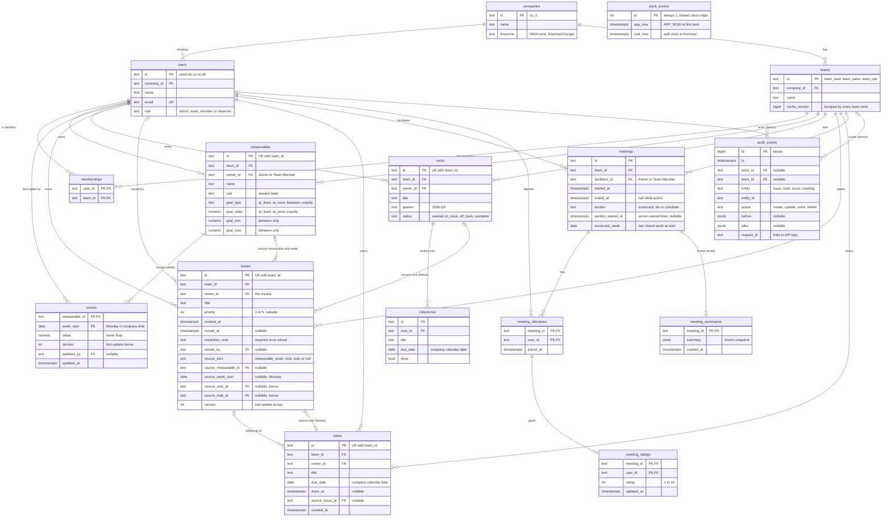
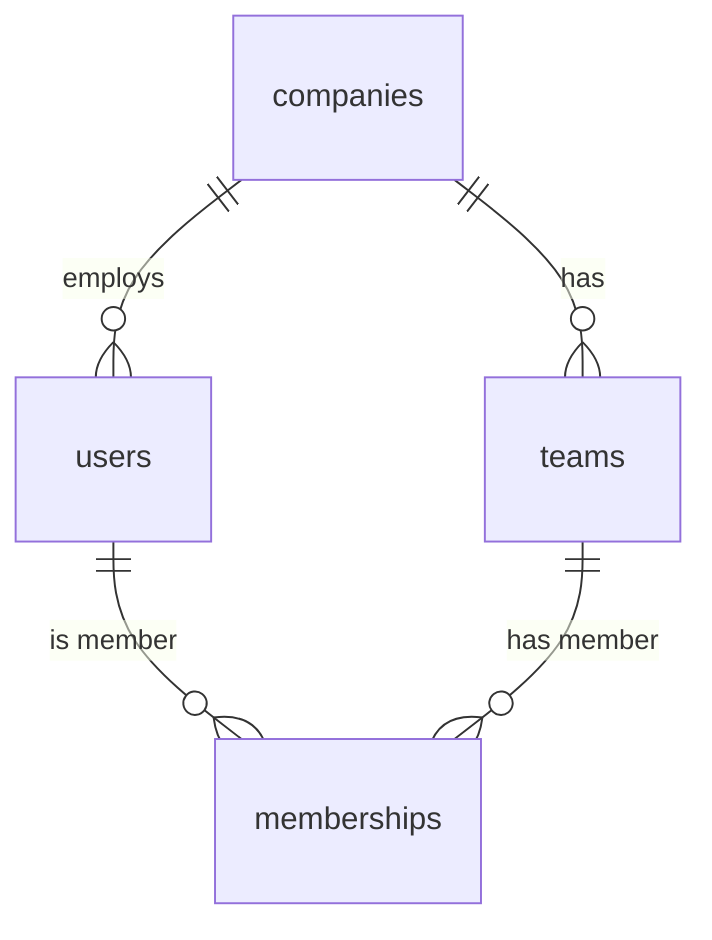
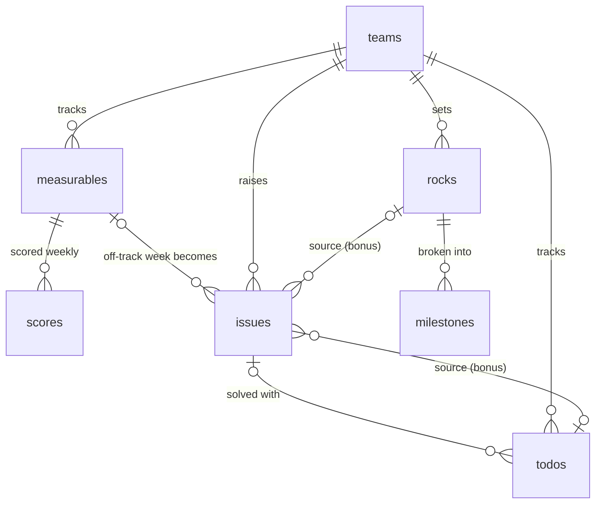
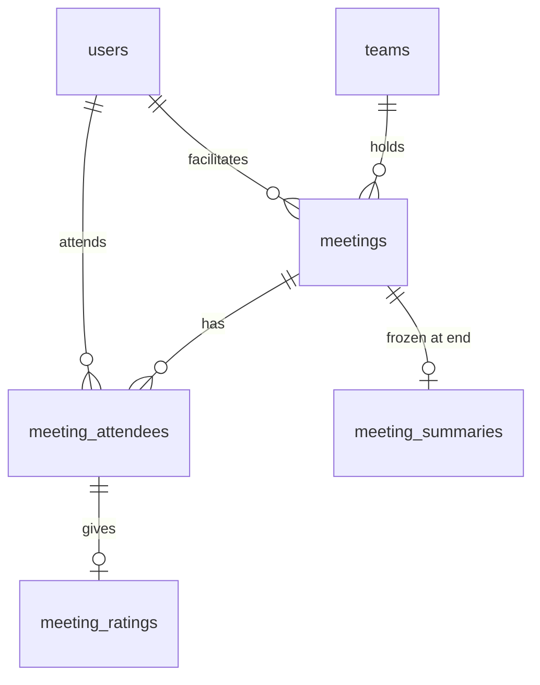

# Database Schema

Planned Postgres schema for the EOS / Level 10 Meeting app. **Status: planning.** Alembic migrations will be generated from this design, and this file must be updated with any change.

GitHub renders the Mermaid diagram below directly. Use the diagram's zoom and pan controls, or open the raw file in any Mermaid viewer.

**Legend:** `PK` primary key, `FK` foreign key, `UK` unique. Crow's-foot lines: `||` exactly one, `|o` zero or one, `o{` zero or many. A `|o` end means the foreign key column is nullable.

## Entity relationship diagram



`alembic_version` (migration bookkeeping) is left out of the diagram.

## Focused views (relationships only)

The complete diagram is dense because `users` and `teams` link to almost everything. These smaller views show one area each; columns are in the complete diagram above.

### Teams, people and access



### The weekly loop: Scorecard, Rocks, Issues, To-Dos



### Level 10 Meeting



## Constraints the diagram cannot show

Mermaid draws single-column links only. These are the rules the database itself enforces, so invalid data is rejected even if the API has a bug (brief 2.7, "Data integrity").

### Same-team composite foreign keys

Every cross-entity link carries `team_id`, so a row can never point at another team's data.

| Child columns | References | Purpose |
|---|---|---|
| `issues (source_measurable_id, team_id)` | `measurables (id, team_id)` | An Issue's source Measurable is in the same team |
| `issues (source_rock_id, team_id)` | `rocks (id, team_id)` | Bonus: same for a Rock source |
| `issues (source_todo_id, team_id)` | `todos (id, team_id)` | Bonus: same for a To-Do source |
| `todos (source_issue_id, team_id)` | `issues (id, team_id)` | A follow-up To-Do links to an Issue of its own team |
| `meeting_ratings (meeting_id, user_id)` | `meeting_attendees (meeting_id, user_id)` | Only attendees can rate |

Each referenced table gets `UNIQUE (id, team_id)` to make these possible.

### Unique and partial unique indexes

| Index | Definition | Rule it enforces |
|---|---|---|
| `ux_issues_open_measurable_week` | `issues (source_measurable_id, source_week_start) WHERE solved_at IS NULL AND source_kind = 'measurable_week'` | **No duplicate Issues** for one Measurable and week, even under concurrent clicks (brief 2.6) |
| `ux_issues_open_rock` (bonus) | `issues (source_rock_id) WHERE solved_at IS NULL AND source_kind = 'rock'` | Same rule for Rocks |
| `ux_issues_open_todo` (bonus) | `issues (source_todo_id) WHERE solved_at IS NULL AND source_kind = 'todo'` | Same rule for To-Dos |
| `ux_meetings_one_active` | `meetings (team_id) WHERE ended_at IS NULL` | One active meeting per team |
| `users_email_key` | `users (email)` | One account per email |
| Primary keys | `scores (measurable_id, week_start)`, `memberships (user_id, team_id)`, `meeting_attendees (meeting_id, user_id)`, `meeting_ratings (meeting_id, user_id)` | One score per cell, one membership, one attendance, one rating per attendee |

### CHECK constraints

| Table | Check |
|---|---|
| `users` | `role IN ('admin', 'team_member', 'observer')` |
| `measurables` | `goal_type IN ('at_least', 'at_most', 'between', 'exactly')`; `between` requires `goal_min` and `goal_max` with `goal_min <= goal_max` and `goal_value IS NULL`; the other types require `goal_value` and null min/max |
| `scores` | `extract(isodow FROM week_start) = 1` (Mondays only); `abs(value) <= 1e9` |
| `rocks` | `status IN ('on_track', 'off_track', 'complete')`; `quarter ~ '^[0-9]{4}-Q[1-4]$'` |
| `issues` | `priority IS NULL OR priority BETWEEN 1 AND 5` |
| `issues` | Solved state is consistent: `solved_at IS NULL` implies `resolution_note IS NULL` and `solved_by IS NULL`; `solved_at IS NOT NULL` implies `btrim(resolution_note) <> ''` (seeded solved Issues have no `solved_by`, so it stays nullable) |
| `issues` | `source_kind` matches its columns: `measurable_week` sets exactly `source_measurable_id` + `source_week_start`; `rock` sets only `source_rock_id`; `todo` sets only `source_todo_id`; `NULL` sets none |
| `issues` | `source_week_start` is a Monday when set |
| `meetings` | `section IN ('scorecard', 'ids', 'conclude')`; `ended_at IS NULL OR ended_at >= started_at` |
| `meeting_ratings` | `rating BETWEEN 1 AND 10` |
| all titles and names | `btrim(title) <> ''` and a length limit (e.g. 200) |

### Role rules (triggers)

A plain foreign key cannot check a user's role, so these use constraint triggers. The API checks the same rules first to return a clear `403`/`422`; the trigger is the safety net.

| Trigger | On | Rule |
|---|---|---|
| `check_owner_eligible` | `measurables`, `rocks`, `issues`, `todos` (insert, and update of `owner_id`) | Owner is not an Observer, and is either an Admin or a member of the row's team (decision 5) |
| `check_facilitator_eligible` | `meetings` | Facilitator is an Admin or a Team Member of that team |
| `check_rater_eligible` | `meeting_ratings` | Rater is not an Observer; ratings are rejected once the meeting has ended |

## Database roles (least privilege)

Created by `db/init/` on first start. See section 3.15 of the development plan.

| Role | Used by | Privileges |
|---|---|---|
| `eos_owner` | Migrations, seed, rules report, test resets | Owns the schema: DDL, `TRUNCATE`, everything |
| `eos_app` | The API (all Uvicorn workers) | `SELECT`, `INSERT`, `UPDATE`, `DELETE` on app tables; `USAGE` on sequences. No DDL, no `TRUNCATE` |
| `eos_readonly` | Startup banner | `SELECT` only |

Default privileges are set so tables created by later migrations get the same grants automatically. An SQL injection bug in the API could still read or change rows its role allows, but could not drop or truncate tables or change the schema.

## Indexes for the main reads

| Index | Serves |
|---|---|
| `issues (team_id, solved_at)` | Unsolved and solved Issue lists |
| `todos (team_id, due_date)` | To-Do list, overdue flags, weekly completion |
| `measurables (team_id)`, `rocks (team_id, quarter)`, `milestones (rock_id)` | Team page sections |
| `meetings (team_id, ended_at)` | Active meeting lookup, ended meeting list |
| `memberships (team_id)` | Team member and owner lists (the PK starts with `user_id`) |
| `audit_events (team_id, ts)` | Bonus audit view |
| `scores` primary key | Scorecard grid (13 weeks per Measurable) |

## Design notes

- **IDs are `text`.** The seed ids (`u1`, `m1`, `t12`, `mt1`, ...) are kept exactly, because the rules report is keyed by them. New rows get an app-generated `text` id with the same kind of prefix (for example `i_` plus a random suffix).
- **Time types:** every instant is `timestamptz`, stored in UTC. Calendar values (`due_date`, `week_start`, `scorecard_week`) are `date` in company time. The company zone lives in `companies.timezone`. No column stores a UTC offset.
- **Scores are `numeric(14,4)`** with a range CHECK (absolute value up to 1e9), read as Python `Decimal`, so boundary comparisons like `3.0 <= 3.0` are exact.
- **Computed values are not stored:** Measurable status, To-Do completion rate, overdue flag, Rock status and progress, Issue order and meeting rating all come from the pure rules module at read time. Storing them would go stale when "now" or the data changes, and the rules report must be computable at any date. The single exception is the frozen `meeting_summaries` snapshot, which is stale on purpose.
- **Seeded meetings** have no section history. They are stored with `section = 'conclude'` and `section_started_at = NULL`, which is why that column is nullable.
- **`teams.cache_version`** is incremented in the same transaction as every team-scoped write (scores, Issues, To-Dos, meeting actions). Redis cache keys include it, so a cached read model can never be served after the data it was built from changed, even if Redis is outdated or briefly unreachable. See section 3.14 of the development plan.
- **`version` columns** on `scores` and `issues` support the lost-update bonus (`If-Match` gives `409`). Without that header, the last save wins, as the brief requires for scores.
- **`clock_anchor`** holds one row: the shared origin of the ticking clock. Every API worker computes `now = app_now + (wall clock - real_now)` from it, so all workers show the same meeting timer and a worker restart does not reset it. The row is replaced when the `APP_NOW` setting changes. Required because the API runs several Uvicorn workers.

## Snapshot shape (`meeting_summaries.summary`)

Mirrors the rules report's meeting format so one function (`build_meeting_summary`) produces both. Example for seeded meeting `mt2`, hand-computed from `seed.json` (to be confirmed by tests):

```json
{
  "meeting_id": "mt2",
  "team_id": "team_lead",
  "facilitator_id": "u2",
  "started_at": "2026-11-04T15:00:00Z",
  "ended_at": "2026-11-04T16:20:00Z",
  "scorecard_week": "2026-10-26",
  "measurable_status": {
    "m1": "off_track",
    "m2": "on_track",
    "m3": "on_track",
    "m4": "off_track",
    "m5": "on_track"
  },
  "issues_solved": ["i6"],
  "todos_created": ["t30"],
  "attendee_ids": ["u1", "u2", "u3", "u4", "u5"],
  "rating": 8.3
}
```
